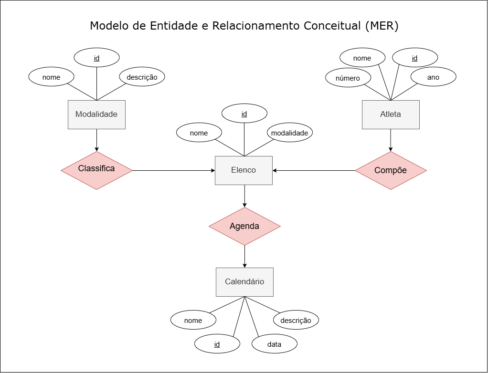
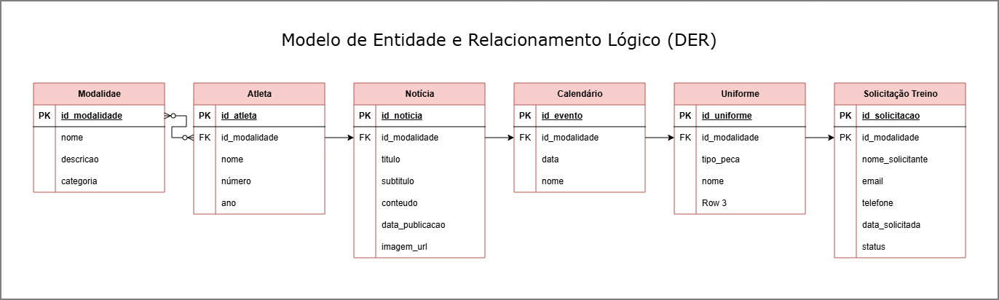
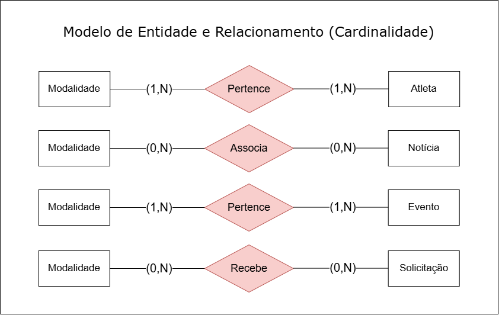

# SESI Esporte Amparo - Semestre 2 🏆

Bem-vindo à documentação do repositório referente ao 2º semestre de desenvolvimento do projeto **SESI Esporte Amparo**, referente ao desenvolvimento do projeto no **2º Semestre**. Este repositório centraliza as especificações, estrutura de banco de dados e arquivos do sistema voltado para a gestão e acompanhamento de atividades esportivas e atletas da unidade do SESI Amparo.

---

## 🔍 Visão Geral do Projeto

O **SESI Esporte Amparo** é uma solução de software focada no gerenciamento de turmas, modalidades esportivas, matrículas de alunos/atletas, frequência, professores/treinadores e eventos esportivos locais.

No 2º Semestre, o foco principal do projeto esteve centrado na **modelagem relacional avançada**, estruturação lógica e física de banco de dados, regras de negócio para alocação de turmas/espaços e prototipação das funcionalidades essenciais.

---

## 🎯 Objetivos

1. **Gestão de Alunos e Atletas:** Informações dos Atletas do Sesi Esporte Amparo;
2. **Controle de Modalidades:** Organização de modalidades esportivas (vôlei, futsal, handbol e tênis de mesa), calendário, notícias e uniformes;
3. **Gestão de Treinos** Disponibilidade de treinos visando saúde e foco dentro e fora das quadras;
4. **Insentivo ao Esporte** Incentivar o esporte com foco na saúde;
5. **Acompanhamento de Eventos/Torneios:** Agendamento de jogos, campeonatos e eventos internos e externos da unidade.

---

## 💻 Arquitetura e Tecnologias

- **Frontend:** Modelagem html com style.css (VsCode);
- **Modelagem de Dados:** MySQL Workbench e XAMPP;
- **Linguagem / Backend:** JavaScript com VsCode;
- **Documentação e Versionamento:** Git & GitHub.

---

## 🗄️ Modelagem de Banco de Dados

### Modelo de Entidade e Relacionamento Conceitual (MER)



### Modelo de Entidade e Relacionamento Lógico (DER)



### Regras de Negócio e Relacionamentos (Cardinalidades)



---

## 🚀 Abrir o site (v1 - sem banco de dados)

1. **Clique no site a seguir para abrir o Sesi Esporte Amparo:**

[Sesi Esporte Amparo](https://miguelpignata.github.io/site_sesi_esporte_amparo/)

---

## 🚀 Como Executar o Projeto (v2 - full stack)

1. **Pré-requisitos:**
   * Tenha o **Node.js** e o **XAMPP** instalados na sua máquina.
   * Inicie o serviço **MySQL** no painel de controle do XAMPP.

2. **Configurar o Banco de Dados:**
   * Abra o MySQL Workbench ou outra ferramenta de sua preferência.
   * Execute o script localizado na pasta do projeto: `script.sql`.

3. **Abra o Terminal no seu computador e execute o comando:**
   ```bash
   git clone https://github.com/miguelpignata/sesi_esporte_amparo.git
   ```

4. **Instalar as Dependências:**
   * Abra o terminal na pasta raiz do projeto e execute:
     ```bash
     npm install
     ```

5. **Executar a Aplicação:**
   * Inicie o servidor em modo de desenvolvimento com o comando:
     ```bash
     npm run dev
     ```
   * O servidor rodará em: `http://localhost:3000`.

---

## 👥 Contribuidores

- **Miguel Pignata** - *Desenvolvimento do Sistema por completo e auxiliar de tarefas* - [@miguelpignata](https://github.com/miguelpignata)
- **Enzo Macedo** - *Fotógrafo e principal responsável pela organização dos atletas* - [@enzo-macedo](https://github.com/enzo-macedo)
- **Davi Cardeal** - *Desenvolvimento do MER DER e editor de fotos* - [@Cardiall7](https://github.com/Cardiall7)
- **Thiago Amaral** - *Auxiliar de desenvolvimento e fotografia* - [@thiagodelimao24-bot](https://github.com/thiagodelimao24-bot)
- Equipe de desenvolvimento do SESI Esporte Amparo.
